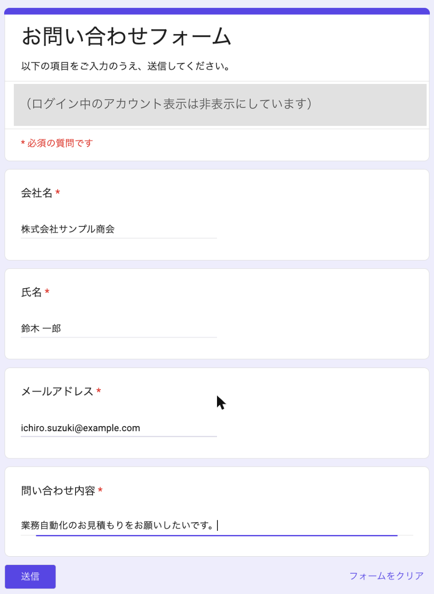
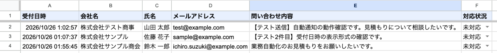
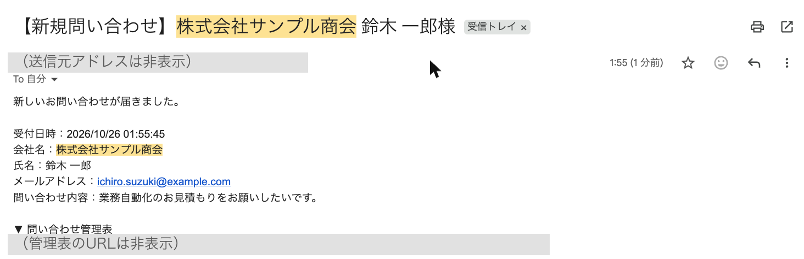
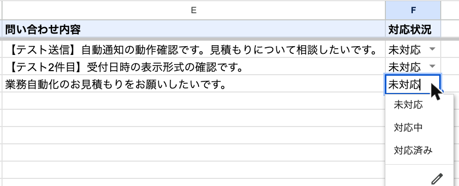

# 問い合わせフォーム自動通知（Google Apps Script）

Googleフォームに問い合わせが届くと、**スプレッドシートに自動で記録**し、**担当者のGmailに通知メールを送る**仕組みです。
初期設定は `setup()` 関数を1回実行するだけで、フォーム・管理表・自動実行の設定（トリガー）がすべて自動で作られます。

## 動作の様子

すべて例示用のデータ（example.com など）です。ログイン中のアカウントやURLは塗りつぶしています。

**① 動く前：お客様がフォームに入力する**



**② 動いた後：送信と同時に、管理表へ1行追加される（対応状況は「未対応」）**



**③ 動いた後：担当者のGmailに通知が届く（件名に会社名と氏名）**



**④ 対応状況はプルダウンで切り替えられる**



## できること

| 機能 | 内容 |
|---|---|
| フォーム自動作成 | 会社名・氏名・メールアドレス・問い合わせ内容（すべて必須、メールは形式チェック付き） |
| 管理表へ自動記録 | 受付日時と全項目を1行ずつ追加。見出し行は固定表示 |
| 対応状況の管理 | 「対応状況」列に初期値「未対応」を自動入力。プルダウンで「対応中」「対応済み」に変更可能 |
| 通知メール | 件名 `【新規問い合わせ】{会社名} {氏名}様`、本文に全項目・受付日時・管理表のURL |
| すぐ返信できる | 通知メールに「返信」すると、問い合わせた人のアドレス宛てになる |

## 使う人のメリット

- **問い合わせの見落とし防止**：届いた瞬間にメールで気づける。フォームの管理画面を見に行く必要がない
- **対応漏れの防止**：「未対応」のまま残っている行を見れば、返信していない問い合わせが一目で分かる
- **転記作業がゼロ**：メールから表へのコピペが不要。入力ミスもなくなる
- **追加費用なし**：Googleアカウントだけで動く（無料のGmailアカウントで1日100通まで送信可能）

## 導入手順

### 必要なもの
- Googleアカウント
- Node.js（[公式サイト](https://nodejs.org/ja)からインストール）

### 手順
1. Apps Script APIを有効にする
   https://script.google.com/home/usersettings を開き、「Google Apps Script API」をオンにする
2. このフォルダで必要な道具を入れ、Googleにログインする
   ```bash
   npm install
   npx clasp login
   ```
3. GASプロジェクトを作り、コードをアップロードする
   ```bash
   npx clasp create --type standalone --title "問い合わせ通知" --rootDir src
   npx clasp push --force
   ```
   ※ `create` で `src/appsscript.json` が上書きされた場合は、元の内容に戻してから `push` してください
4. GASの編集画面を開く（`npx clasp open-script`）
5. 関数のプルダウンで `setup` を選び「▷ 実行」→ 権限を許可する
   （「Googleで確認されていません」と出たら「詳細」→「〜に移動」）
6. 実行ログに表示される「回答用フォームURL」をお客様向けに案内する

`setup()` は2回目以降に実行しても重複して作られません（作成済みのURLを表示するだけ）。
URLを忘れたときは `showInfo()` を実行すると再表示できます。

## カスタマイズできる点

`src/Code.js` 冒頭の `CONFIG` と `FIELDS` を書き換えて `npx clasp push` するだけで変更できます。

| 変えたいこと | 場所 |
|---|---|
| 通知先アドレス（複数ならカンマ区切り） | `CONFIG.NOTIFY_TO` |
| フォーム名・管理表のファイル名・シート名 | `CONFIG.FORM_TITLE` / `SHEET_FILE_NAME` / `SHEET_NAME` |
| 対応状況の選択肢・初期値 | `CONFIG.STATUS_OPTIONS` / `STATUS_DEFAULT` |
| 日時の表示形式 | `CONFIG.DATE_FORMAT`（メール）／`CONFIG.SHEET_DATE_FORMAT`（管理表） |
| フォームの項目（電話番号・希望日などの追加） | `FIELDS` に1行追加（`type` は `text` / `email` / `paragraph`） |
| メール件名・本文 | `onFormSubmit()` 内の `subject` と `lines` |

さらに拡張する例：問い合わせ者への自動返信メール、Slack/Chatworkへの通知、未対応が3日続いたらリマインド、担当者の自動割り振り。

※ 項目・名前の変更は、新しく `setup()` で作るフォーム・管理表に反映されます。作成済みのものを作り直す場合は、スクリプトのプロパティ（`FORM_ID`・`SHEET_ID`）を削除してから `setup()` を実行してください。

## ファイル構成

```
01-form-notify/
├── src/
│   ├── Code.js          … 本体（setup / onFormSubmit / showInfo）
│   └── appsscript.json  … タイムゾーン(Asia/Tokyo)と必要最小限の権限
├── README.md
├── demo.md              … デモ動画の台本
└── .gitignore           … 認証ファイル等をGitから除外
```

## 使用している権限

フォーム作成、スプレッドシート作成、トリガー作成、メール送信、実行者のメールアドレス取得の5つだけです。Gmailの受信箱を読む権限やドライブ全体へのアクセス権限は使いません。
