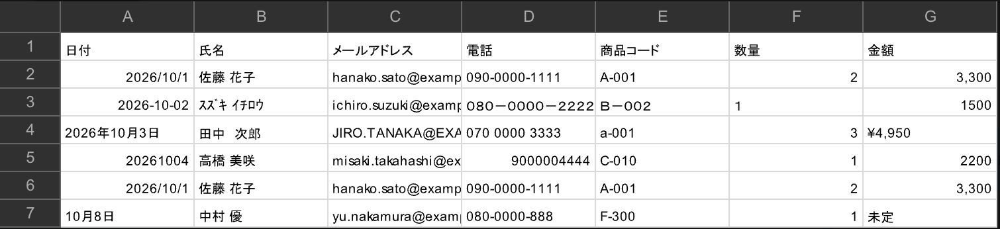
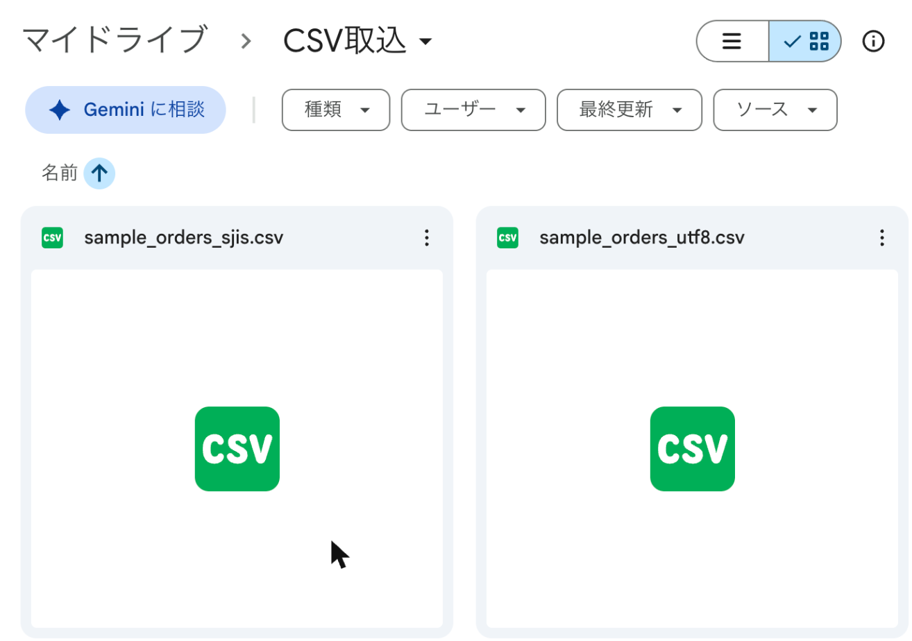
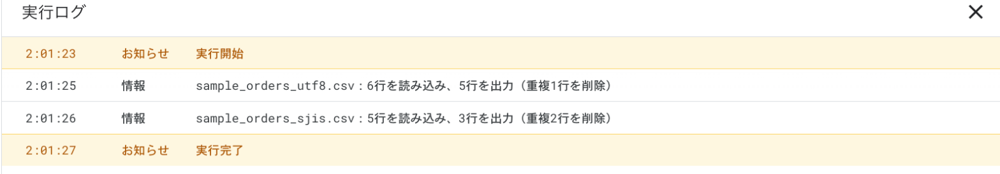
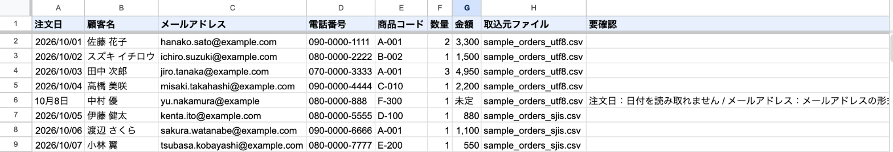

# CSV自動整形 → スプレッドシート出力（Google Apps Script）

Googleドライブの指定フォルダにCSVを置くと、**決まった列の並びと書式に自動で整えて**、別のスプレッドシートに追記する仕組みです。
日付の書き方、全角/半角、重複行といった「CSVの表記ゆれ」を、手作業なしでそろえます。

初期設定は、ドライブに取り込み用フォルダを作り、`setup()` 関数を1回実行するだけです。出力用スプレッドシートと自動実行の設定（トリガー）が作られます。

## 動作の様子

すべて架空のデータです（`samples/` のCSV）。

**① 動く前：表記がばらばらのCSV**（日付の書き方、半角カタカナ、全角の数字と記号、「¥」、重複行が混在）



**② 動く前：ドライブの「CSV取込」フォルダにCSVを置く**（1つはUTF-8、もう1つはExcelで保存したShift_JIS）



**③ 動いた後：ファイルごとに読込行数・出力行数・削除した重複行数を記録**



**④ 動いた後：決まった列の並び・書式にそろって出力される**（列の並びが違う2つ目のCSVも同じ表に。読み取れない値は「要確認」に理由を記録）



## できること

| 機能 | 内容 |
|---|---|
| 置くだけで自動処理 | フォルダ「CSV取込」にCSVを置くと、10分以内に整形して追記 |
| 列の並びを統一 | 見出しの名前がファイルごとに違っても（例：「日付」「受注日」「購入日」）、同じ列として決まった順に並べる |
| 日付の統一 | `2026-10-1`、`2026年10月1日`、`20261001`、`2026.10.01`、`R8.10.1`、`令和8年10月1日` などを `2026/10/01` にそろえる |
| 全角/半角の統一 | 英数字・記号は半角に、半角カタカナは全角に（`ｽｽﾞｷ`→`スズキ`、`Ｂ－００２`→`B-002`）。空白は1つにまとめる |
| 項目ごとの整形 | メールアドレスは小文字に、携帯電話は `090-0000-0000` 形式に、金額は「¥」「,」を除いて数値にする |
| 重複行の削除 | 整形したあとの内容で比べるので、表記ゆれのある重複も削除できる。ファイル内の重複も、過去に取り込んだ行との重複も対象 |
| 要確認の表示 | 読み取れない日付・形式の崩れたメールアドレスなどは、勝手に直さず「要確認」列に理由を書く |
| 処理履歴 | ファイルごとに読込行数・出力行数・重複削除数・要確認数を記録。同じファイルは二度処理しない |
| 文字コード自動判定 | UTF-8（BOM付きも可）と Shift_JIS（Excelで保存したCSV）の両方に対応 |
| 安全設計 | ドライブは**読み取り専用**の権限だけを使う（元のCSVを変更・移動・削除しない）。「=」で始まる値が数式として動かない |

## 使う人のメリット

- **CSVの手直しが不要**：取引先やシステムごとに形式が違うCSVを、毎回Excelで直す作業がなくなる
- **集計ミスの防止**：表記ゆれのある重複を取り除くので、売上や件数の二重計上を防げる
- **問題のある行がすぐ分かる**：「要確認」列を絞り込めば、目で確認すべき行だけを見られる
- **元データは安全**：元のCSVには一切手を加えないので、いつでも元の状態を確認できる
- **追加費用なし**：Googleアカウントだけで動く

## 導入手順

### 必要なもの
- Googleアカウント
- Node.js（[公式サイト](https://nodejs.org/ja)からインストール）

### 手順
1. Googleドライブの「マイドライブ」直下に、フォルダ「CSV取込」を作る
2. Apps Script APIを有効にする
   https://script.google.com/home/usersettings を開き、「Google Apps Script API」をオンにする
3. このフォルダで必要な道具を入れ、Googleにログインする
   ```bash
   npm install
   npx clasp login
   ```
4. GASプロジェクトを作り、コードをアップロードする
   ```bash
   npx clasp create --type standalone --title "CSV整形" --rootDir src
   npx clasp push --force
   ```
   ※ `create` で `src/appsscript.json` が上書きされた場合は、元の内容に戻してから `push` してください
5. GASの編集画面を開く（`npx clasp open-script`）
6. 関数のプルダウンで `setup` を選び「▷ 実行」→ 権限を許可する
   （「Googleで確認されていません」と出たら「詳細」→「〜に移動」）
7. 実行ログに表示される「出力先スプレッドシートURL」を開く
8. `samples/` のCSVを「CSV取込」フォルダに置いて、動きを試す

すぐに処理したいときは `processCsv()` を手動で実行できます。

## サンプルCSV（`samples/`、すべて架空のデータ）

| ファイル | 内容 |
|---|---|
| `sample_orders_utf8.csv` | UTF-8（BOM付き）。日付の書き方がばらばら、全角/半角の混在、重複行1行、わざと崩した行1行 |
| `sample_orders_sjis.csv` | Shift_JIS。列の並び・見出し名が違う、和暦の日付、上のファイルとの重複とファイル内の重複 |
| `sample_orders_add.csv` | 追加分。半角カタカナ・全角記号・固定電話、取り込み済みの行との重複、年のない日付 |

3つを順に置くと、11行が出力され、重複4行が削除されます。
`npm test` で、同じ整形処理をPC上で試せます（Googleへの接続は不要）。

## カスタマイズできる点

`src/Code.js` 冒頭の `CONFIG` と `COLUMNS` を書き換えて `npx clasp push` するだけで変更できます。

| 変えたいこと | 場所 |
|---|---|
| 取り込み用フォルダ名・出力先のファイル名 | `CONFIG.INPUT_FOLDER_NAME` / `OUTPUT_FILE_NAME` |
| チェック間隔（1・5・10・15・30分） | `CONFIG.INTERVAL_MINUTES`（変更後はトリガーの作り直しが必要） |
| 出力する列・並び順 | `COLUMNS` の並びを入れ替える、行を追加・削除する |
| 見出し名の読み替え | `COLUMNS` の `aliases` に見出し名を追加（例：「受付日」を注文日として扱う） |
| 列ごとの整形ルール | `type`（`date` / `text` / `email` / `phone` / `code` / `number`）を指定。`normalizeValue_()` で処理を追加できる |
| 日付の出力形式 | `CONFIG.DATE_FORMAT` / `SHEET_DATE_FORMAT` |

さらに拡張する例：
- 処理したCSVを「処理済み」フォルダに移動する（ドライブの書き込み権限が必要）
- 整形後のデータを月別シートに振り分ける
- 「要確認」の行があったらメールで知らせる
- Excelファイル（.xlsx）の取り込みに対応する

## ファイル構成

```
03-csv-format/
├── src/
│   ├── Code.js          … 本体（setup / processCsv / showInfo と整形処理）
│   └── appsscript.json  … タイムゾーン(Asia/Tokyo)と必要最小限の権限
├── samples/             … 架空データのサンプルCSV
├── test/local-test.js   … PC上で整形処理を試すプログラム（npm test）
├── README.md
├── demo.md              … デモ動画の台本
└── .gitignore           … 認証ファイル等をGitから除外
```

## 使用している権限

ドライブの読み取り（読み取り専用）、スプレッドシートの作成・編集、トリガーの作成の3つだけです。
取り込み用フォルダを自動で作るにはドライブ全体を書き換えられる強い権限が必要になるため、あえてフォルダは手で作る手順にしています。
