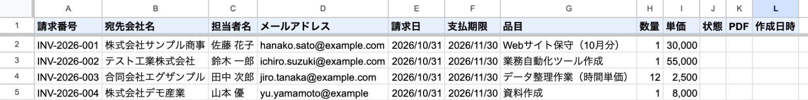
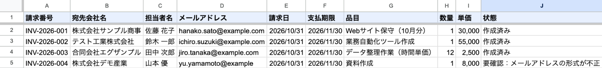
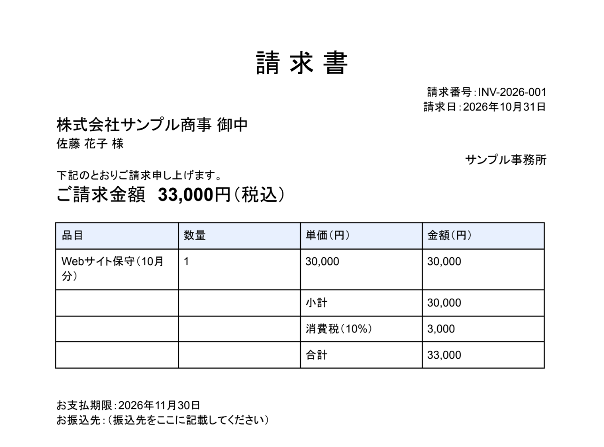
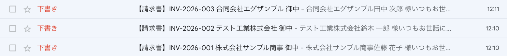
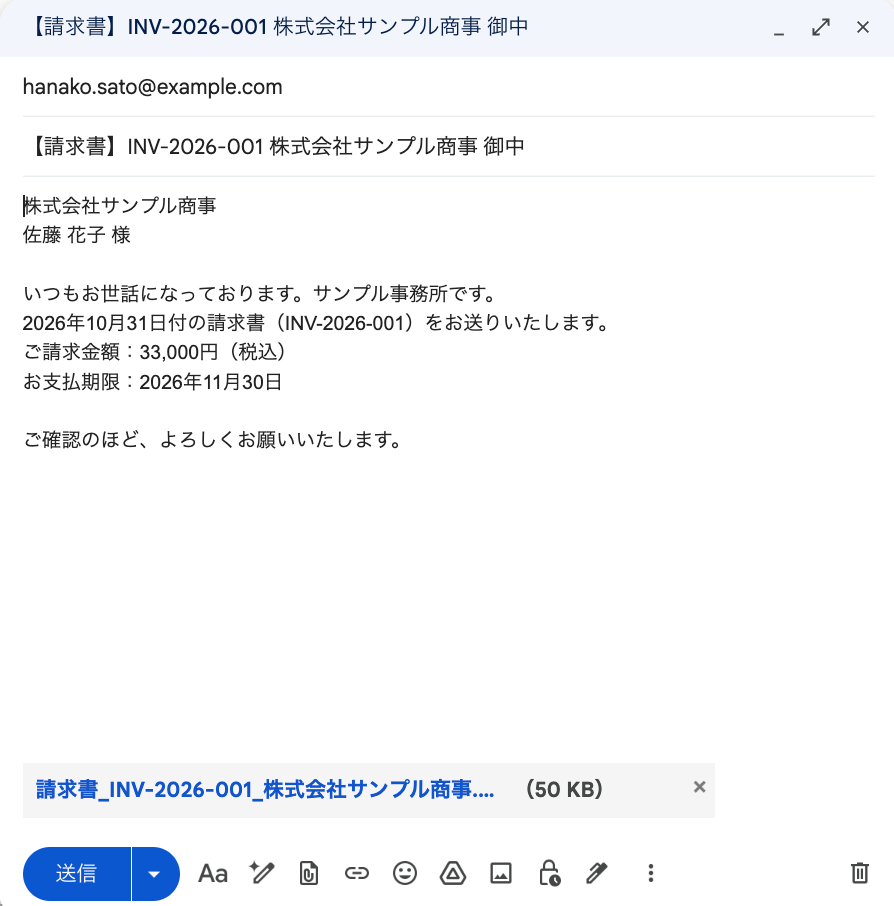

# 請求書PDFの自動作成＋Gmail下書き（Google Apps Script）

スプレッドシートの「請求一覧」に1行＝1枚の請求書として入力すると、**請求書をPDFで自動作成してドライブに保存**し、**宛先ごとにGmailの「下書き」を作る**仕組みです。
**送信はしません。** 担当者が下書きの中身を確認してから送る前提です。

初期設定は `setup()` 関数を1回実行するだけで、請求一覧（サンプル3件入り）・請求書のひな形（Googleドキュメント）・保存用フォルダが作られます。

## 動作の様子

すべて例示用のデータ（example.com・架空の会社名）です。

**① 動く前：請求一覧に入力する**（4件目はメールアドレスをわざと崩した例）



**② 動いた後：3件が「作成済み」に、不備のある1件は作らずに「要確認」と理由を記録**（もう一度実行しても、二重には作られない）



**③ 作られた請求書PDF**（金額・消費税・合計は自動で計算）



**④ 宛先ごとにGmailの下書きができる**



**⑤ 下書きを開くと、宛先・件名・本文・PDFの添付まで入っている**（送るのは人が確認してから）



## できること

| 機能 | 内容 |
|---|---|
| 請求書PDFの自動作成 | ひな形（Googleドキュメント）に、請求番号・宛先・品目・金額などを差し込んでPDFにし、フォルダへ保存 |
| 金額の自動計算 | 数量×単価の小計、消費税（初期設定10%、端数切り捨て）、合計を計算 |
| Gmailの下書き作成 | 宛先・件名・本文（合計金額・支払期限入り）・PDF添付まで入った下書きを作る。**送信はしない** |
| 二重作成の防止 | 作成できた行は「作成済み」になり、次回からは飛ばす |
| 入力チェック | メールアドレスの形式・日付・数量・単価に不備がある行は作らず、「要確認：理由」と記録 |
| 編集できる請求書 | PDFと一緒に、同じ内容のGoogleドキュメントも残るので、必要なら手直しできる |
| 安全設計 | Gmailは「下書きの作成」だけ、ドライブは「このプログラムが作ったファイル」だけを扱う権限で動く |

## 使う人のメリット

- **請求書づくりの手間がほぼゼロ**：一覧に入力して実行するだけで、全員分のPDFとメールの下書きがそろう
- **金額の計算ミス・転記ミスを防ぐ**：計算も差し込みもプログラムが行う
- **誤送信の心配が少ない**：いきなり送らず下書きにするので、宛先や添付を確認してから送れる
- **送り忘れ・二重発行を防ぐ**：「作成済み」「要確認」が一覧で分かる
- **追加費用なし**：Googleアカウントだけで動く

## 導入手順

### 必要なもの
- Googleアカウント
- Node.js（[公式サイト](https://nodejs.org/ja)からインストール）

### 手順
1. Apps Script APIを有効にする
   https://script.google.com/home/usersettings を開き、「Google Apps Script API」をオンにする
2. このフォルダで必要な道具を入れ、Googleにログインする
   ```bash
   npm install
   npx clasp login
   ```
3. GASプロジェクトを作り、コードをアップロードする
   ```bash
   npx clasp create --type standalone --title "請求書PDF" --rootDir src
   npx clasp push --force
   ```
   ※ `create` で `src/appsscript.json` が上書きされた場合は、元の内容に戻してから `push` してください
4. GASの編集画面を開く（`npx clasp open-script`）
5. 関数のプルダウンで `setup` を選び「▷ 実行」→ 権限を許可する
   （「Googleで確認されていません」と出たら「詳細」→「〜に移動」）
6. 実行ログに出る「請求一覧URL」を開き、サンプルを参考に入力する
7. `createInvoices` を選んで「▷ 実行」→ ドライブの「請求書PDF」フォルダとGmailの下書きを確認する

`setup()` は2回目以降に実行しても重複して作られません。途中で止まった場合も、前に作ったフォルダを使い回します。
`npm test` で、金額計算・入力チェック・下書きの中身・二重作成の防止をPC上で試せます（Googleへの接続は不要）。

## カスタマイズできる点

`src/Code.js` 冒頭の `CONFIG` を書き換えて `npx clasp push` するだけで変更できます。

| 変えたいこと | 場所 |
|---|---|
| 発行者名 | `CONFIG.ISSUER` |
| 消費税率 | `CONFIG.TAX_RATE` |
| メールの件名・本文 | `CONFIG.MAIL_SUBJECT` / `MAIL_BODY`（`{請求番号}` `{合計}` などの差し込みに対応） |
| 請求書の見た目 | 作成された「請求書ひな形」ドキュメントを直接編集（`{{項目名}}` の部分に値が入る）。ロゴや振込先もここに書ける |
| ファイル名・フォルダ名 | `CONFIG.SHEET_FILE_NAME` / `TEMPLATE_NAME` / `FOLDER_NAME` |

さらに拡張する例：
- 1枚の請求書に複数の品目を載せる（品目シートを別に用意する）
- 毎月決まった日に自動で作る（時間主導型トリガー）
- 見積書・納品書にも対応する
- 送信済みかどうかを、Gmailの送信履歴と照らし合わせて記録する

## ファイル構成

```
04-invoice-pdf/
├── src/
│   ├── Code.js          … 本体（setup / createInvoices / showInfo とPDF・下書きの作成）
│   └── appsscript.json  … タイムゾーン(Asia/Tokyo)、Drive API・Gmail API、必要最小限の権限
├── test/local-test.js   … PC上で試すプログラム（npm test）
├── docs/images/         … README用の画像
├── README.md
├── demo.md              … デモ動画の台本
└── .gitignore           … 認証ファイル等をGitから除外
```

## 使用している権限

スプレッドシート・Googleドキュメントの作成と編集、**このプログラムが作ったドライブのファイルだけ**の作成と編集、**Gmailの下書き作成**の4つです。
Gmailを読む・送る権限や、ドライブ全体にアクセスする権限は使いません（公式の Drive API・Gmail API を使うことで、権限を絞っています）。
