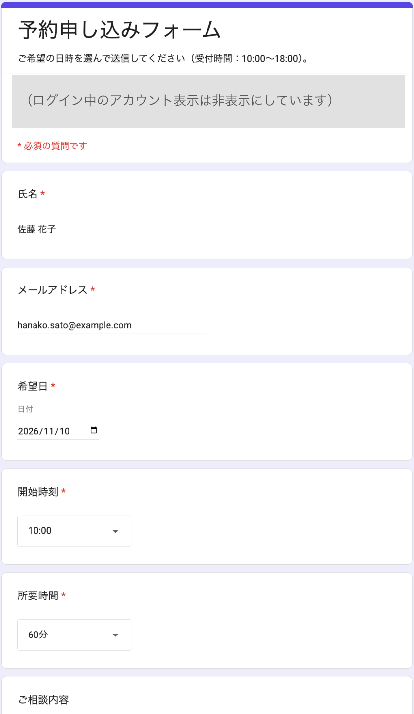
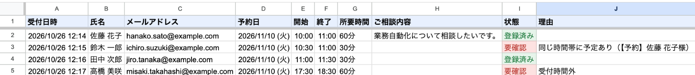
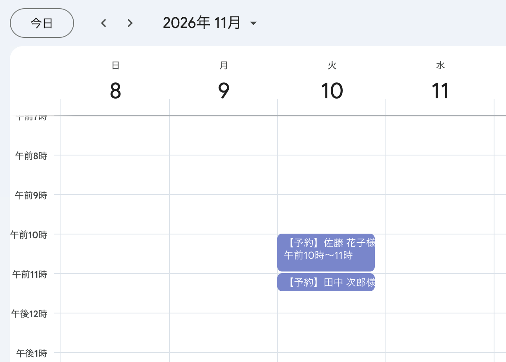

# 予約フォーム → Googleカレンダー自動登録（Google Apps Script）

Googleフォームに予約の申し込みが届くと、**Googleカレンダーに予定として自動登録**し、予約一覧（スプレッドシート）に記録する仕組みです。
**同じ時間帯にすでに予定がある**とき、過去の日時、受付時間外のときは、登録せずに**「要確認」と理由を残します**。

初期設定は `setup()` 関数を1回実行するだけで、予約用カレンダー・予約一覧・予約フォーム・送信時の自動実行（トリガー）が作られます。

## 動作の様子

すべて例示用のデータ（example.com）です。ログイン中のアカウント表示は塗りつぶしています。

**① 動く前：お客様がフォームで希望の日時を選んで申し込む**



**② 動いた後：4件の申し込みが予約一覧に記録される**（重なる・受付時間外の2件は登録せず「要確認」と理由を記録）



**③ 動いた後：予約用カレンダーには、登録できた2件だけが入る**（11:00からの予約は、前の予約が終わった時刻ちょうどなので重ならない）



## できること

| 機能 | 内容 |
|---|---|
| フォームの自動作成 | 氏名・メールアドレス・希望日・開始時刻（30分刻み）・所要時間（30/60/90分）・相談内容 |
| カレンダーへの自動登録 | 申し込みが届いた瞬間に、専用の「予約（デモ）」カレンダーへ「【予約】〇〇様」の予定を登録。相談内容は予定の説明欄へ |
| 重なりのチェック | 同じ時間帯に予定があれば登録せず「要確認：同じ時間帯に予定あり（予定名）」と記録。ちょうど前後に接する予定は重なりとみなさない |
| 受付時間・過去のチェック | 受付時間（初期設定10:00〜18:00）を超える予約、過去の日時の予約も「要確認」に |
| 予約一覧 | 受付日時・予約日時・状態（登録済み／要確認）・理由を1行ずつ記録。「要確認」は赤、「登録済み」は緑で色分け |
| 同時申し込みへの対策 | 同時に届いた申し込みは順番に処理するので、同じ枠に二重登録されない |
| 安全設計 | 申込者を予定の参加者に追加しないため、招待メールは送られない。普段のカレンダーには書き込まない |

## 使う人のメリット

- **予約の転記がゼロ**：フォームからカレンダーへの書き写しが不要になる
- **ダブルブッキングの防止**：重なる予約は自動で止まり、「要確認」で気づける
- **確認すべき予約がすぐ分かる**：予約一覧の赤い「要確認」だけを見ればよい
- **いつでも予定が見える**：カレンダーアプリやスマホから予約状況を確認できる
- **追加費用なし**：Googleアカウントだけで動く

## 導入手順

### 必要なもの
- Googleアカウント
- Node.js（[公式サイト](https://nodejs.org/ja)からインストール）

### 手順
1. Apps Script APIを有効にする
   https://script.google.com/home/usersettings を開き、「Google Apps Script API」をオンにする
2. このフォルダで必要な道具を入れ、Googleにログインする
   ```bash
   npm install
   npx clasp login
   ```
3. GASプロジェクトを作り、コードをアップロードする
   ```bash
   npx clasp create --type standalone --title "予約→カレンダー" --rootDir src
   npx clasp push --force
   ```
   ※ `create` で `src/appsscript.json` が上書きされた場合は、元の内容に戻してから `push` してください
4. GASの編集画面を開く（`npx clasp open-script`）
5. 関数のプルダウンで `setup` を選び「▷ 実行」→ 権限を許可する
   （「Googleで確認されていません」と出たら「詳細」→「〜に移動」）
6. 実行ログに出る「回答用フォームURL」から申し込み、カレンダーの「予約（デモ）」と予約一覧を確認する

`setup()` は2回目以降に実行しても重複して作られません。
`npm test` で、日時の読み取り・受付時間の判定・重なりの判定・登録の流れをPC上で試せます（Googleへの接続は不要）。

## カスタマイズできる点

`src/Code.js` 冒頭の `CONFIG` を書き換えて `npx clasp push` するだけで変更できます。

| 変えたいこと | 場所 |
|---|---|
| 受付時間 | `CONFIG.OPEN_HOUR` / `CLOSE_HOUR` |
| 開始時刻の間隔・所要時間の選択肢 | `CONFIG.SLOT_MINUTES` / `DURATIONS`（フォームを作り直すときに反映） |
| 予定のタイトル | `CONFIG.EVENT_TITLE` |
| 普段のカレンダーの予定とも重ならないか調べる | `CONFIG.ALSO_CHECK_DEFAULT_CALENDAR` を `true` に（予定名は記録せず「別の予定」と書く） |
| カレンダー名・フォーム名・予約一覧のファイル名 | `CONFIG.CALENDAR_NAME` / `FORM_TITLE` / `SHEET_FILE_NAME` |

さらに拡張する例：
- 申込者に予約確定・要確認のメールを自動で送る
- 定休日や祝日の予約を「要確認」にする
- 1つの時間帯に複数人まで受け付ける（定員）
- 担当者ごとにカレンダーを分ける

## ファイル構成

```
05-form-to-calendar/
├── src/
│   ├── Code.js          … 本体（setup / onFormSubmit / showInfo / formatSheet と判定処理）
│   └── appsscript.json  … タイムゾーン(Asia/Tokyo)と必要な権限
├── test/local-test.js   … PC上で試すプログラム（npm test）
├── docs/images/         … README用の画像
├── README.md
├── demo.md              … デモ動画の台本
└── .gitignore           … 認証ファイル等をGitから除外
```

## 使用している権限

フォームの作成・編集、スプレッドシートの作成・編集、カレンダーの表示・編集、トリガーの作成の4つです。
カレンダーを新しく作って予定を入れるには、カレンダー全体の権限が必要です。ただしプログラムが書き込むのは、自分で作った「予約（デモ）」カレンダーだけです（普段のカレンダーは、設定で重なりの確認を有効にしたときだけ読み取ります）。
